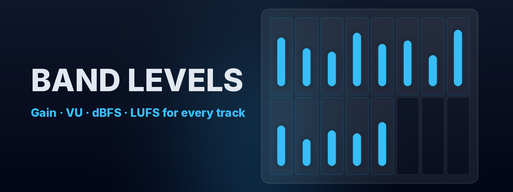

# Band Levels

**Every track's gain, VU, dBFS, and LUFS on the big screen while the band plays.**

```bash
scripts/run-service.sh   # terminal 1: bridge on :8000
curl -X POST localhost:8000/api/v1/levels -H 'content-type: application/json' \
  -d '{"schema_version":1,"source":"demo","tracks":[{"track_id":"vox","gain":0.72,"vu":-2.5,"dbfs":-8.1,"lufs":-16.4}]}'
```

The VOX box on the Apple TV updates within one refresh.



Band Levels is a native tvOS dashboard plus a small Python bridge on the Mac that runs Logic Pro. The dashboard shows 16 fixed slots in two rows of eight. Your 13 live tracks fill the first 13 boxes and the last three stay open for later.

| What you get | How |
| --- | --- |
| Gain per track | Logic's fader position, read by the community [Logic Pro MCP](https://github.com/MongLong0214/logic-pro-mcp) server |
| VU, dBFS peak, momentary LUFS | Measured from Logic's track outputs routed into [BlackHole](https://github.com/ExistentialAudio/BlackHole) |
| Pick the headline metric | Gain, VU, dBFS, or LUFS from the segmented control on the Apple TV |
| Tunable periods | dBFS window, VU integration, LUFS window, Logic poll, publish rate, stale timeout, and screen refresh |
| Manual or scripted levels | `POST /api/v1/levels` with strict validation and logged rejections |
| No accounts | Every screen is public; there is nothing to sign in to |

Logic Pro's [Scripter API](https://support.apple.com/en-il/guide/logicpro/lgce3905a48c/mac) only processes MIDI, and SSL 360 / [360 Link](https://support.solidstatelogic.com/hc/en-gb/articles/17183407536285-SSL-360-Link-User-Guide) documents no external level API, so neither is used as a direct source. Details are in [docs/ARCHITECTURE.md](docs/ARCHITECTURE.md).

## Quick start

Requirements: macOS with Logic Pro, [uv](https://docs.astral.sh/uv/), Xcode 16 or later, an Apple TV on the same network.

```bash
git clone https://github.com/levensailor/tvos-levels.git
cd tvos-levels
cp .env.example .env
cp config/tracks.example.json config/tracks.json
scripts/run-service.sh
```

The bridge listens on `PORT` from `.env` (default `8000`) and logs to the console and `logs/app.log`. The script runs exactly:

```bash
uv run uvicorn main:app --reload --port "${PORT:-8000}"
```

after loading `PORT` and `UVICORN_HOST` from `.env` with python-dotenv. Check it:

```bash
curl localhost:8000/health
curl localhost:8000/api/v1/snapshot
```

## Connect Logic Pro

1. **Audio meters (BlackHole).** Install BlackHole 16ch:

   ```bash
   brew install blackhole-16ch
   ```

   In Logic, set each track's output (or a post-fader send) to its own BlackHole channel: VOX to 1, BGV 1 to 2, and so on, matching `audio_channels` in `config/tracks.json`. Use an Aggregate Device in Audio MIDI Setup if you also need to hear the mix.

2. **Gain (Logic Pro MCP).** Install the community server:

   ```bash
   brew tap MongLong0214/logic-pro-mcp https://github.com/MongLong0214/logic-pro-mcp
   brew install logic-pro-mcp
   ```

   Grant **Accessibility** and **Automation** (Logic Pro and System Events) to the Terminal app that starts the bridge, in System Settings → Privacy & Security. Keep the Logic tracks visible. Name your Logic tracks to match `logic_track_name` in `config/tracks.json`.

3. **Enable the sources** in `.env`:

   ```bash
   LEVEL_SOURCES=json,logic,blackhole
   ```

   Restart the bridge. `GET /api/v1/config` shows whether each source connected.

Every setting lives in `.env` or `config/tracks.json`:

| Setting | Default | Purpose |
| --- | --- | --- |
| `PORT`, `UVICORN_HOST` | `8000`, `0.0.0.0` | Listener; `0.0.0.0` lets the Apple TV connect |
| `TRACKS_CONFIG_PATH` | `config/tracks.json` | Slots, names, Logic names/indexes, BlackHole channels |
| `LEVEL_SOURCES` | `json` | Any of `json`, `logic`, `blackhole` |
| `BLACKHOLE_DEVICE_NAME` | `BlackHole 16ch` | Input device name match |
| `AUDIO_SAMPLE_RATE`, `AUDIO_BLOCK_SIZE` | `48000`, `1024` | Capture format; match Logic's sample rate |
| `VU_REFERENCE_DBFS`, `METRIC_FLOOR_DB` | `-18`, `-96` | 0 VU calibration and silence floor |
| `DBFS_PEAK_WINDOW_MS`, `VU_INTEGRATION_MS`, `LUFS_WINDOW_MS` | `300`, `300`, `400` | Measurement windows |
| `LOGIC_POLL_MS`, `PUBLISH_INTERVAL_MS`, `STALE_AFTER_MS` | `1000`, `100`, `3000` | Update periods |
| `LOGIC_MCP_COMMAND`, `LOGIC_MCP_ARGS`, `LOGIC_PRO_BUNDLE_ID` | `LogicProMCP`, empty, `com.apple.logic10` | How the bridge launches Logic Pro MCP |

The full wire format, validation rules, and track layout schema are in [docs/BRIDGE_PROTOCOL.md](docs/BRIDGE_PROTOCOL.md).

## Install on Apple TV

1. Fetch the Satoshi typeface (its license allows embedding in your app but not committing it to a public repo; the app falls back to the bundled Inter):

   ```bash
   scripts/fetch-fonts.sh
   ```

2. Set your signing team and bridge address:

   ```bash
   cp BandLevels/Config/DeveloperSettings.example.xcconfig BandLevels/Config/DeveloperSettings.xcconfig
   open BandLevels/BandLevels.xcodeproj
   ```

   Edit `DeveloperSettings.xcconfig`: `DEVELOPMENT_TEAM` is your Team ID from [developer.apple.com/account](https://developer.apple.com/account), `BAND_LEVELS_BUNDLE_ID_PREFIX` is a reverse-DNS prefix you own, and `BAND_LEVELS_BRIDGE_HOST` is the Mac's LAN IP or `name.local`. You can also pick the team under Signing & Capabilities; automatic signing is on.

3. Pair the Apple TV: on the Apple TV open Settings → Remotes and Devices → Remote App and Devices; in Xcode open Window → Devices and Simulators and pair it.

4. Select the Apple TV as the run destination and press Run. The bridge host and port can be changed later on the Apple TV under Settings.

**Login:** none. The app and the bridge have no accounts, passwords, or tokens. Anyone on the local network can view the dashboard, so run the bridge only on a network you trust.

## Develop

```bash
uv sync
uv run ruff check .
uv run pytest
```

Swift tests run on an Apple TV simulator from Xcode (Product → Test) or in CI. [GitHub Actions](https://github.com/levensailor/tvos-levels/actions/workflows/ci.yml) runs lint, unit tests, port checks, payload acceptance and rejection checks, the tvOS simulator tests, and an unsigned Release build on every push. Regenerate the app icon and top-shelf art with:

```bash
uv run --no-project --with pillow python scripts/generate_tvos_assets.py
```

## Links

| Asset | URL |
| --- | --- |
| Source | [github.com/levensailor/tvos-levels](https://github.com/levensailor/tvos-levels) |
| CI | [Actions](https://github.com/levensailor/tvos-levels/actions/workflows/ci.yml) |
| Hosted service | None; the bridge runs on your Mac |

See [CONTRIBUTING.md](CONTRIBUTING.md), [CHANGELOG.md](CHANGELOG.md), and [THIRD_PARTY_NOTICES.md](THIRD_PARTY_NOTICES.md).

## Author

[](https://github.com/levensailor)

Released under the [MIT License](LICENSE).
