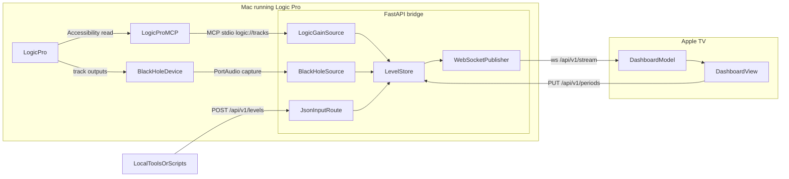
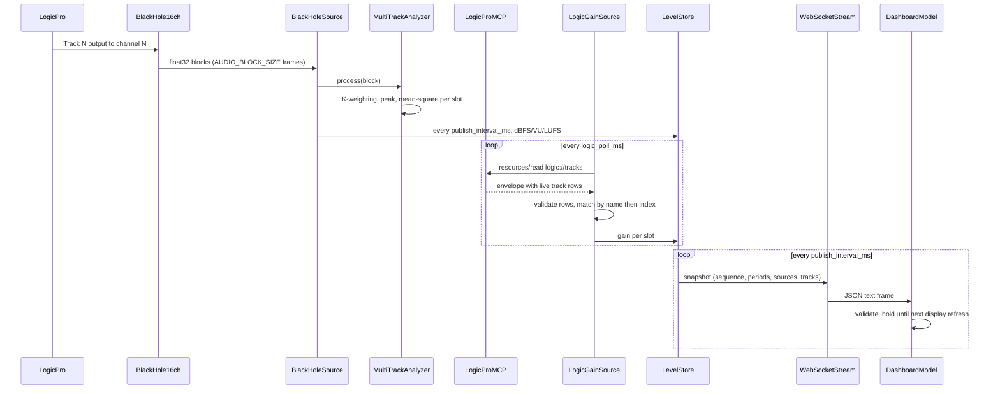

# Architecture

Band Levels has two parts: a Python bridge on the Mac that runs Logic Pro, and a native tvOS app that renders what the bridge publishes.

## Source evaluation

| Candidate | What the documentation shows | Result |
| --- | --- | --- |
| Logic Pro Scripter | Apple's [Scripter API](https://support.apple.com/en-il/guide/logicpro/lgce3905a48c/mac) is a JavaScript MIDI-processing plug-in API | No access to audio meters; not used |
| SSL 360 / 360 Link | The [360 Link guide](https://support.solidstatelogic.com/hc/en-gb/articles/17183407536285-SSL-360-Link-User-Guide) covers hosting VST3 plug-ins and showing their metering on SSL UC1/UF8/UF1 hardware | No documented external API, export, or protocol for live levels; not used |
| [Logic Pro MCP](https://github.com/MongLong0214/logic-pro-mcp) v3.18.0 (community, MIT) | `logic://tracks` returns each track's live header fader `volume` as a normalized 0–1 contract, read through macOS Accessibility | Used for **gain** only. It is not a first-party Apple API |
| [BlackHole](https://github.com/ExistentialAudio/BlackHole) (GPL-3.0 driver) | Documented 2/16/64-channel zero-latency loopback for routing audio between apps | Used for **VU, dBFS, LUFS**: Logic routes each track to its own BlackHole channel and the bridge measures it |

## Audio-level data flow

## Bridge internals

| Module | Responsibility |
| --- | --- |
| [`main.py`](../main.py) | Loads `.env` with python-dotenv, configures logging, builds the app |
| [`level_bridge/settings.py`](../level_bridge/settings.py) | Parses and range-checks every environment value |
| [`level_bridge/track_config.py`](../level_bridge/track_config.py) | Validates slots, ids, names, Logic matching, and channel maps |
| [`level_bridge/metrics.py`](../level_bridge/metrics.py) | BS.1770 K-weighting, windowed peak, VU, and LUFS |
| [`level_bridge/sources/blackhole.py`](../level_bridge/sources/blackhole.py) | PortAudio capture thread feeding the analyzer |
| [`level_bridge/sources/logic_mcp.py`](../level_bridge/sources/logic_mcp.py) | MCP stdio client, envelope validation, slot matching, reconnect with backoff |
| [`level_bridge/store.py`](../level_bridge/store.py) | Thread-safe state, staleness, snapshot assembly |
| [`level_bridge/api.py`](../level_bridge/api.py) | Routes, validation-error logging, WebSocket stream |
| [`level_bridge/logging_config.py`](../level_bridge/logging_config.py) | One rotating file handler (`logs/app.log`, 1 MiB x 3) and one stdout handler, America/New_York timestamps |

## tvOS internals

| Type | Responsibility |
| --- | --- |
| `AppSettings` | `@Observable` connection identifiers, emphasis, and display refresh, persisted in UserDefaults with Info.plist defaults |
| `DashboardModel` | `@Observable` 16-slot state, WebSocket reconnect loop, display-refresh throttle, payload rejection, periods `PUT` |
| `SnapshotDecoder` | Decodes and validates the wire contract before anything reaches the UI |
| `DashboardView` | Header plane overlapping the 2 x 8 grid plane, 0.3x background parallax, metric emphasis picker |
| `TrackTileView` / `EmptySlotView` | Populated and available boxes, 250 ms focus lift |
| `Theme` / `FontRegistry` | Dimensional Layering tokens; Satoshi then Inter then system font at exact 400/600/800 weights |

Views hold models with `@State` (in `BandLevelsApp`) and read them through Observation; there are no `ObservableObject` publishers.

## Limitations

- Logic Pro MCP reads Logic's UI through Accessibility. The Terminal (or app) that launches the bridge needs Accessibility and Automation permission, Logic's tracks must be visible, and an unreadable fader can read as `0.0`. Gain shows `stale` when polling stops.
- Logic Pro MCP v3.18.0 qualifies desktop Logic Pro 12.3; other versions are best effort.
- VU, dBFS, and LUFS measure what Logic sends to BlackHole. Route each track's output (or a post-fader send) to its own BlackHole channel. Meters reflect Logic's routing choice, not SSL hardware meters.
- BlackHole 16ch carries up to 16 mono tracks. Stereo tracks need two channels each; use BlackHole 64ch for more.
- The bridge has no authentication. Run it only on a trusted local network.
